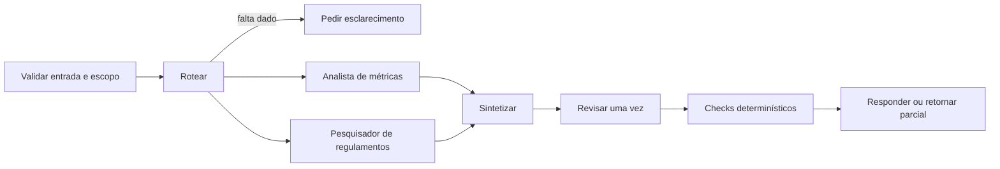

# 05 — Agentes de investigação com ferramentas controladas

**Estado demonstrado:** Planejado. Evidências de 28/10/2026 quando aplicável.

Este documento preserva requisitos e design do estudo. Etapas futuras, quantidades planejadas e critérios de aceite não comprovam execução. Consulte o estudo de caso para escopo, resultados e limites atuais.

**Estado:** design planejado. **Competência:** contratos, estado, roteamento, ferramentas e avaliação de agentes. **Dependências:** métricas Gold do 01, recuperação do 03 e protocolo experimental do 04; fixtures permitem desenvolver os contratos antes dessas entregas.

## Objetivo e requisitos

Responder a perguntas analíticas e de regulamento com ferramentas rastreáveis, sem permitir que o modelo escolha livremente uma operação externa.

| ID | Requisito | Aceite futuro |
| --- | --- | --- |
| RF01 | Identificar métricas/regulamentos/ambiguidade | Rota correta no conjunto rotulado |
| RF02 | Validar argumentos antes de ferramenta | Rejeitar biblioteca, período ou operação não permitidos |
| RF03 | Compor evidências em uma resposta | Cada número/documento ligado ao resultado da ferramenta |
| RF04 | Limitar a execução | No máximo 4 tool calls, 1 revisão e 8 transições |
| RF05 | Tratar falha sem inventar resultado | Estado parcial/erro explícito e possibilidade de retomada |
| RF06 | Persistir estado mínimo | Histórico de transições recuperável por execution_id |
| RNF01 | Autorização fora do prompt | Contexto confiável validado pelo runtime |
| RNF02 | Comparar com solução mais simples | Agente único e roteamento por regra como referências |

Fora do MVP: autonomia para criar tabelas, executar SQL livre, navegar na internet, mandar mensagens ou alterar permissões. Ferramentas de escrita se restringem a um rascunho no próprio laboratório.

## Contratos e dados

Entrada: `request_id`, `question`, `library_id`, `period_start`, `period_end`, `trusted_scope`, `config_version`. O usuário pode pedir um escopo, mas o runtime o intersecta com `trusted_scope` vindo da aplicação. Na demonstração, identidades/permissões são simuladas e isso é informado.

| Ferramenta | Argumentos | Saída e restrição |
| --- | --- | --- |
| consultar_metricas | biblioteca e período validados | métricas, unidade, data_reference, release_id; consulta parametrizada em views permitidas |
| buscar_regulamento | tema, biblioteca, data | trechos, IDs, versão e vigência; filtro obrigatório |
| salvar_rascunho | request_id e conteúdo validado | draft_id e hash; chave idempotente; sem publicação externa |

Resposta: `status`, `answer`, `metric_references`, `document_references`, `missing_inputs`, `execution_id`. Guardar tool error como objeto tipado, sem confundir falha com resultado vazio.

Estado proposto em `workspace.estudos_ai.aurora_agent_execucoes` e `aurora_agent_transicoes`: entrada validada, rota, etapa, contadores, referências, última transição e erro. Não persistir credenciais ou raciocínio interno.

## Design da máquina de estados

Para rota combinada, consultar métricas e documentos com o mesmo contexto validado e reunir evidências. Começar sequencialmente; paralelismo só será avaliado depois de medir o ganho e o limite de concorrência.

O revisor pode apontar problemas, mas não aprovar ferramenta ou ampliar acesso. Se a única revisão não corrigir uma inconsistência, finalizar com resultado parcial/revisar em vez de entrar em loop. Limite por requisição proposto: 90 segundos, com teto menor de timeout por ferramenta e cancelamento cooperativo verificado no ambiente.

## Stack e decisões

| Lib/componente | Uso |
| --- | --- |
| Python stdlib, `enum`, `dataclasses` | Máquina de estados explícita e limites |
| `pydantic` | Entrada, estado, tool args e saída |
| `databricks-sdk` + SQL parametrizado | Endpoint de LLM e acesso às métricas permitido |
| Recuperador do projeto 03 | Busca documentada e filtrada |
| Delta | Estado, deduplicação de rascunhos e evidências |
| MLflow Tracing/Tracking | Rota, tool calls, geração, revisão e comparações |
| `pytest` | Cenários futuros de contrato, limites e erro |

Não exigir framework de agentes no MVP. LangGraph pode ser um experimento futuro de persistência/roteamento, com o mesmo contrato e testes; não é necessário para demonstrar uma orquestração correta.

## MLflow e experimentos

Experimento: `.../05_agentes/experimentos/orquestracao`. Dataset proposto: 40 tarefas originais, 20 dev, 10 val e 10 teste, estratificadas em métricas, regulamentos, combinado, esclarecimento e fora de escopo.

| ID | Comparação | Pergunta experimental |
| --- | --- | --- |
| A01 | Roteamento por regra × LLM | A flexibilidade melhora o acerto de rota? |
| A02 | Agente único × especialistas | A divisão melhora sucesso por tarefa dentro do orçamento? |
| A03 | Sem revisão × uma revisão | A correção adicional compensa chamadas/latência? |
| A04 | Ferramentas válidas × falhas simuladas | O agente retorna limite/erro de forma previsível? |

Guardar configuração dos agentes, prompts, ferramentas habilitadas, máximos e snapshot das fixtures. Métricas: sucesso por tarefa, acerto de rota, validade de argumentos, evidências válidas, chamadas, latência, taxa de erro e violações de escopo. Artefatos: grafo, resultados por caso, análise de falhas e trace IDs.

Limite inicial: 80 execuções de tarefa; cada tool call de LLM conta também no orçamento global de consumo. Primeiro avaliar regras/fixtures sem modelo; depois usar o endpoint disponível numa amostra limitada. Não afirmar que multiagente é melhor antes da comparação.

## Validação, roteiro e apresentação

Casos obrigatórios: período ausente, SQL/instrução maliciosa na pergunta, biblioteca fora do escopo, retorno de ferramenta vazio, timeout, resposta com número diferente da ferramenta, falha da revisão, duas chamadas concorrentes com o mesmo request_id e limite de transições.

Metas de integridade: zero execução de ferramenta não permitida e zero número sem referência aceito pelo validador nos casos conhecidos. Sucesso global/latência serão comparados às referências; não presumir um percentual antes de medir.

Roteiro: contratos/fixtures → roteamento por regra → ferramentas → agente único → estados persistentes → especialistas/revisor → comparação e análise de erros. Entregáveis planejados: `01_contratos`, `02_ferramentas`, `03_orquestracao`, `04_avaliacao`, fluxograma e manual de retomada.

**Demonstração:** perguntar por uma mudança de empréstimos, abrir as evidências, adicionar uma dúvida de regulamento, simular timeout e mostrar o limite de execução. Explicar por que o modelo não recebeu permissão para executar SQL livre ou inventar novas ferramentas.

Riscos: autorização derivada do texto, loop, persistência incompleta e complexidade sem ganho. Requisitos abertos: endpoint disponível e escolha do mecanismo de persistência compatível com a conta.

Referências: [MLflow Tracing](https://mlflow.org/docs/latest/genai/tracing/) e [avaliação de agentes](https://mlflow.org/docs/latest/genai/eval-monitor/).
